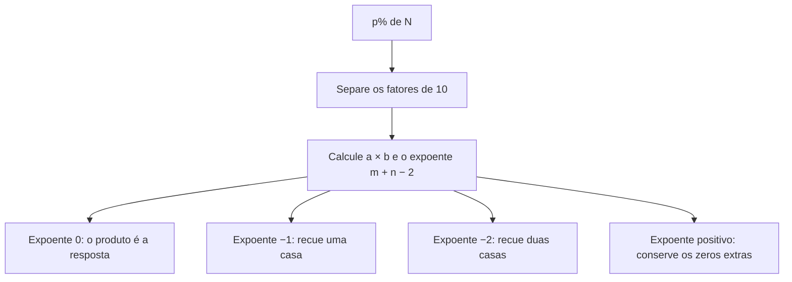

# Mestre da Porcentagem

Caderno de cálculo mental para o método de corte de zeros e vírgula. Dez aulas, correção com o passo da técnica, e o progresso guardado no próprio navegador.

O app está em [`estudo-porcentagem.html`](estudo-porcentagem.html). Abra o arquivo: não há instalador nem servidor obrigatório.

Desenvolvimento do app de estudo por **[Diego Duenhas](https://diegoduenhas.com.br)**.

## A filosofia

Porcentagem não é uma operação nova. É uma multiplicação por uma taxa e uma divisão por 100. A divisão por 100 só desloca a vírgula duas casas para a esquerda. O método dá um nome de gesto a essa identidade, para que ela caiba na memória de trabalho no tempo de uma prova:

1. Conte os zeros que já estão nos dois números.
2. Multiplique só o que sobra.
3. A vírgula anda o que ainda faltar para completar as duas casas que o símbolo `%` exige.

A filosofia do treino segue o mesmo corte. Cada dia ensina um gesto só. A correção devolve o passo, não apenas certo ou errado. O histórico fica na máquina de quem estuda.

O método não substitui a ideia de porcentagem. Ele organiza a aritmética para o caso direto, “quanto é `p%` de `N`”, quando a conta precisa sair de cabeça.

## Como o método funciona

A definição é uma só:

```text
p% de N  =  (p / 100) × N  =  p × N × 10^(−2)
```

Os zeros finais são potências de dez. Escreva a taxa e a base sem esses zeros:

```text
p = a × 10^m
N = b × 10^n
```

`a` e `b` são os números que sobram depois do corte. Então:

```text
p% de N  =  (a × b) × 10^(m + n − 2)
```

O expoente `m + n − 2` é a vírgula:

| Expoente | O que fazer com `a × b` |
| --- | --- |
| `0` | O produto já é a resposta. Os dois zeros foram pagos. |
| `−1` | Recue a vírgula uma casa. |
| `−2` | Recue a vírgula duas casas. |
| maior que `0` | Conserve os zeros que sobraram à direita. |

Um zero que nasce na multiplicação também é um fator `10`. Ele entra na mesma conta. Em `6%` de `50`:

```text
6 = 6 × 10^0
50 = 5 × 10^1
6 × 5 = 30 = 3 × 10^1
expoente total = 1 + 0 + 1 − 2 = 0
resultado = 3
```

O gesto correspondente é: corta o zero de `50`, multiplica `6 × 5 = 30`, e corta o zero que apareceu.



### Os dez gestos do caderno

| Dia | Foco | Notação | Exemplo |
| --- | --- | --- | --- |
| 1 | Dois zeros na base | `m = 0`, `n = 2` | `3%` de `200` → `3 × 2 = 6` |
| 2 | Um zero em cada fator | `m = 1`, `n = 1` | `30%` de `40` → `3 × 4 = 12` |
| 3 | Zeros repartidos, inclusive sobra | `m + n ≥ 2` | `6%` de `1.200` → `6 × 12 = 72` |
| 4 | O segundo zero nasce no produto | o produto aporta um `10` | `6%` de `50` → `6 × 5 = 30` → `3` |
| 5 e 6 | Um zero só | expoente `−1` | `20%` de `13` → `2 × 13 = 26` → `2,6` |
| 7 e 8 | Nenhum zero | expoente `−2` | `3%` de `24` → `3 × 24 = 72` → `0,72` |
| 9 e 10 | Mistura | escolher o expoente antes de multiplicar | identificação rápida |

No Brasil, o ponto de `1.200` é separador de milhar. Os zeros que se cortam são os zeros finais do inteiro `1200`, não a pontuação.

## História: o que tem data

O corte de zeros não foi descoberto num dia, por uma pessoa, com um nome de teorema. Ele é um jeito de ensinar uma identidade antiga. As datas abaixo são da ideia de “por cem”, da vírgula decimal e da proporção. O arranjo em aulas, do jeito que este caderno pratica, é didática recente de estudo para prova.

**Taxa por cem, bem antes do símbolo.** No comércio antigo já se cobrava e se emprestava “por cento”: uma parte em cada cem. Em Roma, a *centesima rerum venalium* era um imposto de um centésimo sobre certas vendas, associado ao período de Augusto. Isso é uma taxa de `1/100`, ainda sem o sinal `%`.

**A proporção que a escola herdou.** A regra de três, achar o quarto termo de uma proporção, aparece em tratados indianos e chineses muito antes da Europa latina. Leonardo de Pisa, o Fibonacci, leva o cálculo comercial com algarismos indo-arábicos ao *Liber abaci*, de 1202. Luca Pacioli fixa essa aritmética de mercadores na *Summa de arithmetica*, de 1494. Niccolò Tartaglia, no século XVI, insiste na matemática prática de medidas, taxas e proporções. É dessa linhagem que sai a regra de três ensinada no Brasil.

**O sinal `%`.** O latim *per centum* e o italiano *per cento* nomeiam a ideia. David Eugene Smith, em *Rara Arithmetica* (1908) e na *History of Mathematics* (1923), acompanha a abreviatura em manuscritos italianos. Antes de 1425 não há um símbolo próprio conhecido. Um texto de aritmética de 1339 ainda escreve formas como “per 100” e “p cento”. Por volta de 1435 aparece `pc` com um pequeno círculo no lugar do `-o` de *cento*. Em 1684 o desenho já é uma fração de dois círculos. Smith observa, em 1925, que a barra inclinada do `%` moderno é tardia. O sinal se consolida ao longo do século XIX. Uma curiosidade registrada por Keith Houston: o círculo do símbolo veio da abreviatura de *cento*, não do algarismo zero. O “corte de zeros” e o desenho do `%` não nasceram juntos.

**A vírgula que anda.** Frações decimais já aparecem antes na matemática árabe, como em al-Uqlidisi, no século X, e em notações práticas como a de Christoff Rudolff, em 1530. Quem escreve o primeiro tratado curto e deliberado, e empurra o uso na Europa, é Simon Stevin. *De Thiende* sai em Leiden em 1585, no mesmo ano em francês como *La Disme*. Stevin mostra que multiplicar ou dividir por 10, 100 ou 1.000 é uma mudança de posição, não uma conta nova. O método deste app é essa observação aplicada ao denominador 100. A vírgula tipográfica que usamos hoje não é a notação de Stevin: ele marcava as casas com círculos numerados. A economia do gesto, porém, é a dele.

**O macete brasileiro.** “Porcentagem em segundos”, “corte de zeros e ajusta a vírgula”, é um empacotamento didático que circula em cursinhos, canais e reportagens de concurso. Não há um descobridor, uma patente ou um artigo que date a invenção desse roteiro. Quem o usa hoje são candidatos e professores de raciocínio quantitativo. Sistemas vizinhos de cálculo mental, como o de Jakow Trachtenberg no século XX ou as apresentações de Arthur Benjamin, também encurtam contas, mas com outros gestos. Não são este método.

## O que a escola brasileira ensina

A tradição escolar monta a proporção e resolve no papel:

```text
p / 100  =  x / N
100x  =  p × N
x  =  (p × N) / 100
```

O resultado é o mesmo. O custo é outro: escrever a proporção, multiplicar números grandes e dividir por 100 no fim, quando a divisão era só uma vírgula.

A outra via da escola transforma a taxa em decimal e multiplica: `15%` de `300` vira `0,15 × 300`. Também é a mesma identidade. O aluno carrega a vírgula desde o começo, em vez de contá-la no expoente.

A [Base Nacional Comum Curricular](https://www.gov.br/mec/pt-br) já pede outro caminho no 6º ano. A habilidade EF06MA13, no documento de 2018, p. 303, manda resolver e elaborar problemas de porcentagem pela proporcionalidade, **sem regra de três**, com estratégia pessoal, cálculo mental e calculadora, em contextos de educação financeira. O objeto de conhecimento é explícito: cálculo de porcentagens por estratégias diversas, sem a regra de três. O corte de zeros é uma dessas estratégias. Ele não briga com a BNCC. Ele dá forma a um cálculo mental que o currículo já solicita e que o hábito da proporção escrita ainda ocupa.

| | Regra de três | Decimal e produto | Corte de zeros |
| --- | --- | --- | --- |
| Ideia | Proporção | `p/100` já na taxa | Potências de dez |
| O que se escreve | Três linhas e uma divisão | Um produto com vírgula | Um produto curto |
| Onde mora a vírgula | Na divisão final por 100 | Dentro de `0,p` | No expoente `m + n − 2` |
| Quando brilha | Relação inversa, “x% de N é tanto, ache N” | Fator de aumento e desconto | “`p%` de `N`” direto |
| Risco típico | Armar a proporção invertida | Perder uma casa decimal | Contar zero a mais ou a menos |

Para `15%` de `300`, os passos mentais ficam assim:

```text
Regra de três
  15/100 = x/300
  100x = 4500
  x = 45

Corte
  300 aporta 10^2
  15 × 3 = 45
  expoente 2 − 2 = 0
```

Não existe ensaio publicado que converta essa diferença de passos numa nota de SAT, GRE, GMAT ou PISA para este macete em particular. A vantagem que se pode afirmar é operacional: menos dígitos na memória e nenhuma divisão final, no tipo de item em que a pergunta já é “calcule `p%` de `N`”.

## Concursos e provas

Em concurso público a porcentagem entra em matemática, raciocínio lógico, administração, atualidades econômicas e provas de área bancária e fiscal. A banca raramente para no “quanto é 8% de 400”. O item direto existe, e nele o corte devolve minutos. O item que decide a nota costuma ser um destes:

- **Aumento e desconto.** Some ou subtraia a taxa de 100% e use o corte no miolo. Aumento de `p%`: multiplique por `1 + p/100`. Desconto de `p%`: multiplique por `1 − p/100`. Exemplo: `R$ 300` com `20%` de aumento → `300 × 1,2`. O `20%` de `300` sai pelo corte, `2 × 30 = 60`, e o novo preço é `360`.
- **Sucessivos.** As taxas não se somam. `+10%` e depois `+20%` não são `+30%`. Os fatores se multiplicam: `1,10 × 1,20 = 1,32`, um aumento de `32%`. `+20%` seguido de `−20%` dá `1,20 × 0,80 = 0,96`, uma queda de `4%`, não um retorno ao início.
- **Parte e todo invertidos.** “40% de um valor é 80” pede `N = 80 / 0,40`, ou a proporção. O corte resolve o `40%` quando a base é conhecida. Quando a base é a incógnita, a regra de três continua o instrumento certo.
- **Base 100.** Se o enunciado só fala em taxas, supor o todo igual a `100` transforma cada porcentagem no próprio número.
- **Troca.** `16%` de `50` é `50%` de `16`, porque a multiplicação comuta: `(16 × 50) / 100 = (50 × 16) / 100`. Vale `8` dos dois lados. Em item quebrado, jogue a taxa para o número mais amigo.

Bancas como Cebraspe, FCC, FGV e Vunesp repetem esse repertório. O caderno treina o núcleo rápido. Aumento, desconto e sucessão são o passo seguinte, com a mesma aritmética.

## Exames internacionais, sem número inventado

O PISA não mede este macete. Mede matemática de jovens de 15 anos. No PISA 2022, o Brasil fez 379 pontos em matemática, e a média da OCDE foi 472. Cerca de 27% dos estudantes brasileiros alcançaram pelo menos o nível 2, contra 69% na média da OCDE. Cerca de 1% chegaram aos níveis 5 ou 6, contra 9%. Os dados são do relatório da OCDE e das notas por país publicadas em dezembro de 2023. Esse fosso descreve a escola, não um experimento com corte de zeros. Ele ajuda a entender por que um cálculo mental explícito importa: muita gente termina o fundamental sem uma estratégia estável para uma taxa simples.

SAT, GRE e GMAT cobram porcentagem, variação percentual e variação sucessiva com limite de tempo e sem calculadora em boa parte dos formatos. O material internacional de preparação ensina a mesma identidade, em geral por âncoras de `1%`, `10%`, `25%` e `50%`, não pelo roteiro brasileiro dos zeros. Não há estudo do College Board, da ETS ou do GMAC comparando “corte de zeros” com regra de três. Comparar os dois procedimentos pelo número de operações, como na tabela acima, é o confronto honesto. Prometer ponto a mais em prova internacional por causa do macete seria inventar um resultado.

## Benefícios

- A conta direta cabe em um produto curto. A vírgula é uma decisão, não uma divisão armada.
- O gesto é o mesmo do 1º ao 10º dia. Muda só quantos zeros existem.
- Treinado, o padrão sobrevive ao relógio de uma prova objetiva.
- A explicação cabe numa linha, então o erro de contagem pode ser revisto.
- Conversar com a habilidade EF06MA13: estratégia pessoal e cálculo mental, sem instalar a regra de três como único caminho.

## Limitações

- Errar a contagem de zeros erra o resultado inteiro. Um zero a mais desloca a vírgula uma casa.
- Zero no meio do número não se corta. Em `101`, o zero não é fator de dez final.
- O ponto de milhar brasileiro (`1.200`) não é vírgula decimal. Confundir os dois quebra o método.
- Porcentagem de porcentagem, sucessão, juros compostos e “ache a taxa” pedem um passo que o corte sozinho não faz.
- O produto `a × b` ainda precisa ser calculado. `47%` de `83` continua uma multiplicação de dois números de dois dígitos. O método só tira o `/100`.
- Não é outro resultado matemático. Quem domina a regra de três com capricho chega no mesmo número. O ganho é de tempo e de carga na memória, no item direto.

## Curiosidades

- O `%` não é “dois zeros cortados por uma barra” na origem. Os círculos vêm da abreviatura de *cento*. A metáfora do corte é pedagógica, e combina com a conta, mas o desenho histórico é outro.
- `p%` de `N` e `N%` de `p` são o mesmo número. A comutatividade é um atalho de prova, não uma coincidência.
- Stevin escreveu *De Thiende* para medidores de vinho, mercadores e mestres de moeda, não para um currículo. O público deste caderno, o candidato sob o relógio, está mais perto desse leitor do que de um tratado.
- Duas casas decimais são exatamente o par de zeros do percentual. Por isso “andar a vírgula” e “cortar zero” são o mesmo ato visto de dois lados.
- Desconto e aumento da mesma taxa não se anulam. `+20%` e `−20%`, nessa ordem, deixam `96%` do valor inicial.

## O app

Um único arquivo HTML. Tailwind e Chart.js vêm de CDN; as fontes são Fraunces e Atkinson Hyperlegible. As dez aulas, a nota e a data ficam em `localStorage`, na chave `porcentagem_progress`. A preferência de tema fica em `porcentagem_theme`.

O botão **Claro** / **Escuro**, na barra, troca o tema e guarda a escolha. Sem escolha salva, o app acompanha o tema do sistema. O capelo ao lado abre um texto selecionável com a filosofia, a notação, a história e o uso em prova. A correção aceita vírgula ou ponto. A análise mostra aulas feitas, taxa de acerto, a curva dos dez dias e o histórico.

## Créditos

App de estudo desenvolvido por **Diego Duenhas**.

[diegoduenhas.com.br](https://diegoduenhas.com.br)

A aritmética é de domínio comum. O desenho das aulas, a interface e este texto de estudo são do app.
